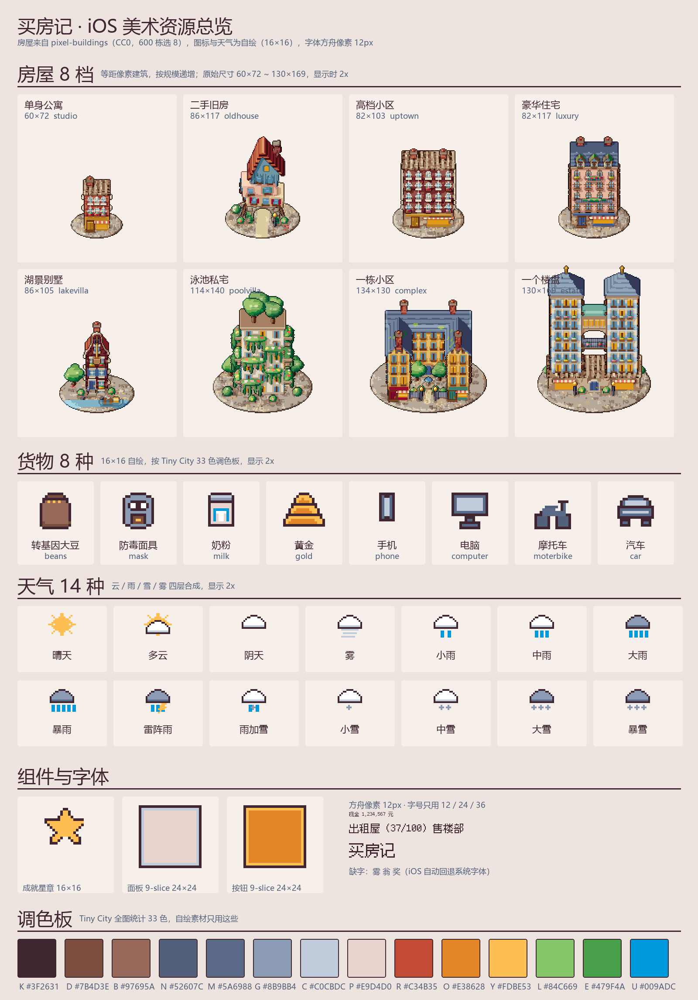

# 买房记

像素风买房模拟经营游戏，iOS 原生实现（SwiftUI，最低 iOS 15）。

## 功能

- 八种货物，三个市场独立刷新行情，切换市场即过一周
- 每周 1~3 条随机事件，以报纸形式叠加在市场栏，逐张点掉
- 八档房屋，价格从 40 万到一个楼盘 4000 万
- 11 项成就、8 项里程碑，均为跨存档累计
- 结算页汇总本局生存周数、净资产、房产与成就
- 本地 JSON 存档，无网络依赖

## 环境要求

| 依赖 | 版本 |
|---|---|
| iOS | 15.0+ |
| Xcode | 15+ |
| XcodeGen | 2.38+ |

## 构建

```bash
cd ios
xcodegen generate
xcodebuild \
  -project BuyHouse.xcodeproj \
  -scheme BuyHouse \
  -configuration Release \
  -sdk iphoneos \
  -destination 'generic/platform=iOS' \
  -derivedDataPath build \
  CODE_SIGNING_ALLOWED=NO CODE_SIGNING_REQUIRED=NO CODE_SIGN_IDENTITY="" \
  build
```

产物为未签名的 `BuyHouse.app`，打包成 IPA：

```bash
mkdir -p Payload
cp -R ios/build/Build/Products/Release-iphoneos/BuyHouse.app Payload/
zip -qry BuyHouse-unsigned.ipa Payload
```

仓库内置 GitHub Actions 工作流 `.github/workflows/ios.yml`，推送 `ios/**` 或 `v*` 标签时自动构建；标签触发时同时创建 Release 并附带 IPA。

## 目录结构

```
ios/
  project.yml               XcodeGen 工程定义
  BuyHouse/
    App.swift               入口
    Theme.swift             调色板、字体、面板与按钮
    Layout.swift            自适应尺寸
    GameData.swift          货物、房屋、成就、天气表
    GameState.swift         存档、交易、周期结算、事件引擎
    Events.swift            事件分类与事件表
    Progress.swift          跨存档的成就与里程碑
    MainView.swift          主界面
    Sheets.swift            页面与弹窗
    Resources/
      Assets.xcassets       素材
      Fonts/                方舟像素 12px
art/
  preview/                  素材与界面设计稿
  _work/                    素材导出脚本
```

## 素材

- 建筑：[pixel-buildings](https://github.com/hoanglong256/pixel-buildings)（CC0 1.0）
- 字体：[方舟像素字体](https://github.com/TakWolf/ark-pixel-font) 12px（SIL OFL 1.1）
- 货物图标、天气、星章、面板与按钮：本项目自绘，使用同一套 33 色调色板



## 许可

代码以 MIT 协议发布，见 [LICENSE](LICENSE)。第三方素材遵循各自协议，详见 [art/SOURCES.md](art/SOURCES.md)。
